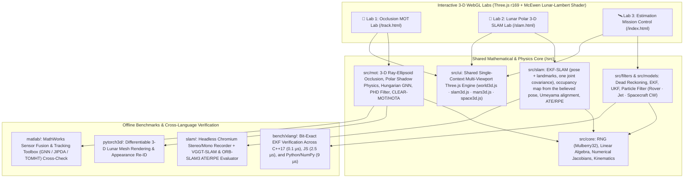

# Lunar Autonomous Perception & Estimation Suite — System Architecture

This repository implements a unified **Three-Lab Interactive 3-D Research Suite** for Lunar South Pole (Artemis-class) autonomous robotics, accompanied by reproducible offline evaluation pipelines in JavaScript, Python (PyTorch3D / NumPy), C++17, and MATLAB.

---

## 1. Unified Three-Lab WebGL Architecture (`http://localhost:8080`)



---

## 2. Directory Structure & Module Responsibilities

```text
NASA_EKF/
├── index.html                  # Lab 3: Multi-Platform State Estimation Mission Control (EKF / UKF / PF)
├── track.html                  # Lab 1: Lunar South Pole Multi-Object Tracking (MOT) Under Occlusion
├── slam.html                   # Lab 2: SLAM lab: live EKF-SLAM vs wheels only, explained step by step
├── server.js                   # Zero-dependency ES-module static HTTP server (Node >= 18)
├── styles.css                  # Shared Mission-Control dark telemetry design system
│
├── src/                        # Browser & Node.js ES Modules (Zero external runtime dependencies)
│   ├── core/                   # Deterministic PRNG, matrix algebra, kinematics, finite-difference Jacobians
│   ├── filters/                # Dead Reckoning, Extended Kalman Filter, Unscented KF, Particle Filter
│   ├── models/                 # Process & measurement models (Mars Rover, GNSS-Denied Jet, CW Spacecraft)
│   ├── mot/                    # 3-D boulder/shadow visibility, Bernoulli existence, Negative-Info EKF, PHD, LiDAR
│   ├── slam/                   # EKF-SLAM engine, Umeyama alignment, ATE/RPE, loop-closure detection
│   ├── platforms/              # True vehicle physics, sensor emulators, fault injection, waypoint autopilot
│   ├── sim/                    # Mission loop, scenario definitions, consistency (ANEES) scoring
│   └── ui/                     # Three.js r169 3-D renderers (world3d.js, slam3d.js, mars3d.js, space3d.js)
│
├── slam/                       # Offline Visual & Stereo SLAM Benchmark Pipeline (VGGT-SLAM vs ORB-SLAM3)
│   ├── README.md               # Complete documentation of the Lunar Polar SLAM experiments
│   ├── record_drive.mjs        # Headless Chromium stereo/mono frame + TUM ground-truth pose recorder
│   ├── score_ate.py            # Sturm (2012) ATE & Geiger (2012) KITTI RPE evaluator (Sim3 & SE3)
│   ├── plot_compare.py         # Top-down Mono VGGT-SLAM vs Stereo ORB-SLAM3 trajectory plotter
│   ├── plot_paths.py           # Diagnostic plotter marking pure-rotation loops & keyframe drop gaps
│   ├── plot_summary.py         # Log-scale ATE % vs Solar Elevation (30°, 7°, 2°) summary figure generator
│   ├── make_video.py           # Side-by-side camera keyframe + 3-D point cloud map video renderer
│   ├── orbslam3/               # Stereo ORB-SLAM3 configuration & calibration files
│   ├── pod/                    # RunPod GPU cluster automation scripts for VGGT-SLAM & ORB-SLAM3
│   └── runs/                   # Recorded trajectories, ground-truth poses, and polar_scores.md
│
├── pytorch3d/                  # PyTorch3D Synthetic Lunar MOTS & Appearance Re-ID Pipeline
├── matlab/                     # MATLAB R2024+ Reference Implementation & Tracker Toolbox Comparison
├── evos/                       # Event-Based Camera (EVOS) Motion Response Fitting
├── experiments/                # Reproducible 20-seed Monte Carlo ablations (results.md)
├── bench/                      # Filter RMSE/ANEES benchmarks & C++17 / Python / JS cross-language proof
├── assets/nasa/                # Official NASA glTF/GLB 3-D models (Draco compressed)
├── vendor/three/               # Vendored Three.js r169 + GLTFLoader + DRACOLoader (100% offline-capable)
└── test/                       # Automated Node.js test suite (filters, models, MOT, SLAM, UI smoke tests)
```
