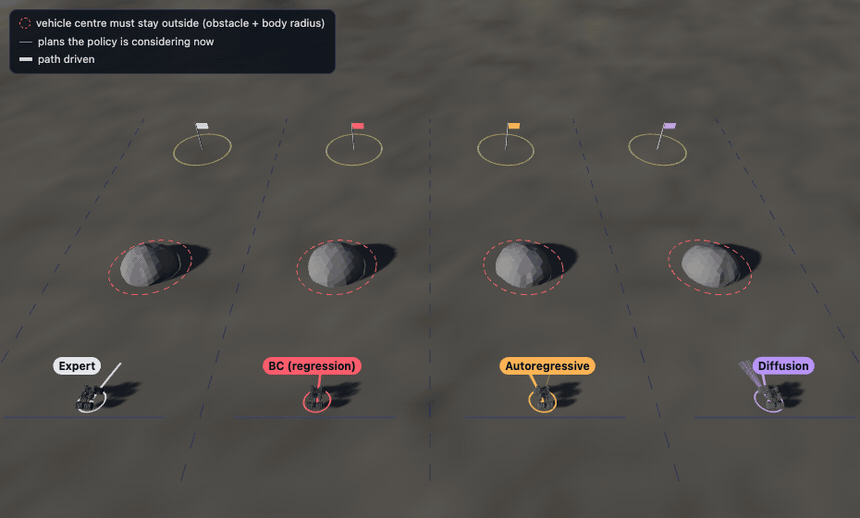

# Multimodal Policy Lab: imitation learning when the expert has two answers

**Question.** An expert rover drives around a rock, on the left or the right. When the rock is dead ahead it picks
either side, 50/50. Five policies learn from the same demonstrations. Which ones copy a *choice*, and which one
copies the *average* of the two choices, which points straight at the rock?



*Run 37 with the rock dead ahead (replay it: `policy.html?run=37`). Thin lines: plans each policy is considering;
dashed ring: where the vehicle's centre may not go.*

| Policy | Output | Loss | Reference |
|---|---|---|---|
| BC (regression) | 8 actions directly | squared error | behaviour cloning baseline |
| Autoregressive | 8 action tokens, one at a time | cross-entropy | RT-2 (Brohan et al. 2023), FAST tokens (Pertsch et al. 2025) |
| Diffusion | 8 actions, denoised from noise in 50 steps | noise-prediction error | Diffusion Policy (Chi et al. 2023) |
| Flow matching | 8 action tokens, moved from noise to a plan along straight paths in 10 steps; adaLN-Zero transformer | velocity error | flow matching (Lipman et al. 2023), π0 (Black et al. 2024), DiT (Peebles & Xie 2023) |
| CVAE | 8 actions from the observation and a random latent code z, one pass; an encoder (training only) puts the expert's side into z | squared error + 0.01 × KL | ACT (Zhao et al. 2023), conditional VAE (Sohn et al. 2015) |

Live, in the browser: `npm start`, then open `http://localhost:8080/policy.html`, or the
[hosted page](https://sadeeqgandalf.github.io/lunar-occlusion-tracking/policy.html). The page runs the exported networks
themselves (float16 weights, ported forward passes), checked against PyTorch by `test/policy.test.js`. A Moon/Road switch
changes only the look: the stalled car on the road is the same circular obstacle as the rock.

## Results

Closed loop: each policy drives every test world from start to goal, re-planning every 1 s from noisy perception and
executing 4 of its 8 actions. A crash is the vehicle body (radius 0.5 m) touching the obstacle. All policies see the same
400 worlds per test and the same perception noise. Five training seeds (each with its own demonstrations, initial weights
and batch order); mean [min–max] after 60 epochs.

| Policy | Random worlds: crash | Rock dead ahead, σ = 0.05 m: crash | Dead ahead: passed on the left |
|---|---|---|---|
| Expert | 0% | 0% | 51% |
| BC (regression) | 0.6% [0.0–1.3] | **19.2% [10.2–33.0]** | 54% [5–88] |
| Autoregressive | 0.3% [0.0–0.7] | 3.5% [1.8–6.0] | 60% [51–76] |
| Diffusion | 0.1% [0.0–0.5] | 0.5% [0.0–2.0] | 56% [41–80] |
| Flow matching | 0% | 0% | 49% [22–65] |
| CVAE | 0.4% [0.0–1.3] | 2.0% [1.3–2.5] | 49% [37–57] |

Every run that did not crash reached the goal. Per-seed values: `policy/results.json` (`seeds`).

What the numbers say:

- **Averaging only hurts when the data has two answers.** In random worlds all five learned policies are about as safe as the
  expert. With the rock dead ahead, BC crashes in 19% of runs, more than any other policy in every seed: it steers
  between the two choices it saw and commits late.
- **Sharp perception exposes it.** At σ = 0.4 m the noisy rock position decides the side for BC as well
  ("Blurry perception" in the lab).
- **BC's side is a fixed bias, not a choice.** Its share of left passes ranges from 5% to 88% across seeds: each fit
  breaks the tie the same way every time. The autoregressive and diffusion policies sample a side, but neither keeps the
  expert's 50/50 balance exactly (51–76% and 41–80% left).
- **Flow matching never crashed** (5 seeds × 800 runs) with 10 sampling steps against diffusion's 50. It still does
  not keep the expert's 50/50 balance in every seed (22–65% left).
- **The CVAE stays closest to the expert's 50/50** (37–57% left in every seed, on both courses) from a single
  network pass, at about 2% dead-ahead crashes: between the autoregressive policy and diffusion.
- **Training loss does not predict safety.** BC's loss falls as steadily as the others' while its dead-ahead crash rate
  stays high (loss chart in the lab).

## Rock field: three choices in a row

A second course with its own demonstrations and networks (the single-rock results above are unchanged). Three rocks
sit 9–10.5 m apart along a lane. The expert returns to the lane centre after each one, so a rock on the centre line is a
fresh 50/50 choice; the rover sees the next two rocks and its heading on the lane (10 numbers instead of 6). In the
"all rocks dead ahead" test the expert's side at one rock matches its side at the rock before only half the time.

| Policy | Random fields: crash | 3 rocks dead ahead, σ = 0.05 m: crash | Dead ahead: rocks passed on the left |
|---|---|---|---|
| Expert | 0% | 0% | 49% |
| BC (regression) | 0.3% [0.0–0.7] | **12.0% [0.2–24.3]** | 54% [1–93] |
| Autoregressive | 0.5% [0.2–1.0] | 1.6% [0.5–2.5] | 53% [40–74] |
| Diffusion | 0% | 0.1% [0.0–0.2] | 56% [43–68] |
| Flow matching | 0% | 0% | 54% [25–73] |
| CVAE | 0.1% [0.0–0.5] | 2.3% [1.5–3.2] | 50% [37–56] |

Three choices did not make BC crash more often than one (12% against 19%). It avoids the rocks by giving up the
choice: in the seed with 0.2% crashes it passes 99% of rocks on the right, in another 93% on the left. Its crash rate
hides that it no longer drives like the expert; the share of rocks passed on each side shows it. Diffusion, flow
matching and the CVAE keep both sides in every seed. Per-seed values: `policy/results_field.json`.

## How it is built

| File | What it does |
|---|---|
| [`sim.py`](sim.py) | both courses, perception noise, the expert (tangent to the keep-out circle of the nearest blocking rock, side fixed per rock), closed-loop rollout |
| [`dataset.py`](dataset.py) | 800 expert runs per course (15,889 and 30,316 (observation, 8-action chunk) pairs); steering noise on executed actions (DART); only runs that reach the goal are kept (all 800, in every training seed) |
| [`tokenizer.py`](tokenizer.py) | uniform (RT-2) and DCT (FAST without BPE) action tokenizers |
| [`model.py`](model.py) | BC regression MLP and the autoregressive transformer (2 layers, d = 64) |
| [`diffusion.py`](diffusion.py) | DDPM policy, cosine schedule, FiLM-conditioned MLP |
| [`flow.py`](flow.py) | flow-matching policy: one token per action, adaLN-Zero transformer, Euler sampling |
| [`cvae.py`](cvae.py) | CVAE policy: encoder (training only), decoder from observation and latent code, KL to N(0, I) |
| [`train_eval.py`](train_eval.py) | per course: trains all five (same data, 60 epochs, AdamW), scores them closed loop, exports seed 0's weights at epochs 0, 2, 10, 60 |
| [`test_policy.py`](test_policy.py) | expert never crashes, takes both sides (at every rock in the field), tokenizers round-trip, schedule ends in noise |

Browser port: [`src/policy/sim.js`](../src/policy/sim.js), [`src/policy/policies.js`](../src/policy/policies.js);
page: [`src/ui/policy-app.js`](../src/ui/policy-app.js). Every run on the page has a link (`?run=…`) that replays it exactly.

## Reproduce

```bash
pip install torch numpy pytest
python policy/train_eval.py      # both courses, 5 seeds each, about 25 min on a laptop CPU
python -m pytest policy          # Python checks
npm test                         # includes the JavaScript-vs-PyTorch parity tests
```

## Limits

One to three obstacles on flat ground; the policy sees obstacle positions and sizes, not pixels; unicycle motion without
slip; a geometric expert, not a human driver; small networks trained for one task.
